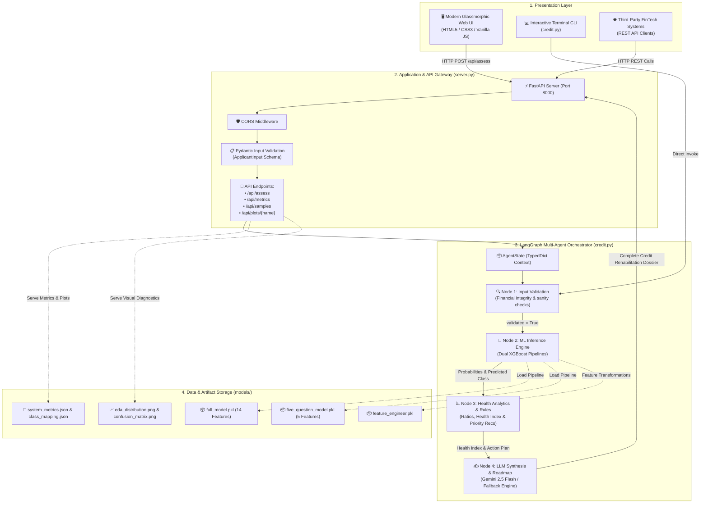
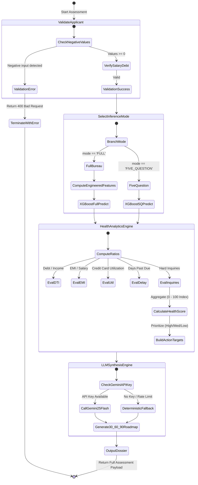
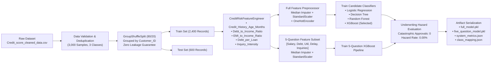
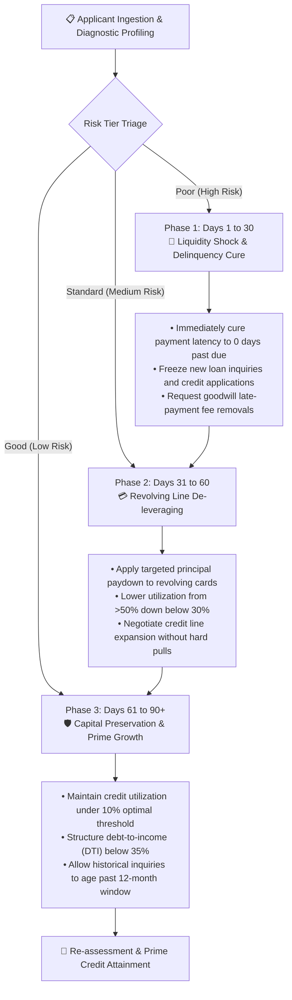
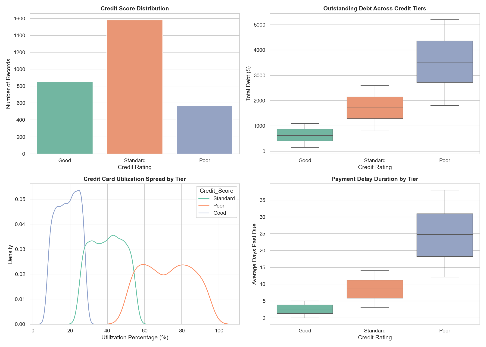
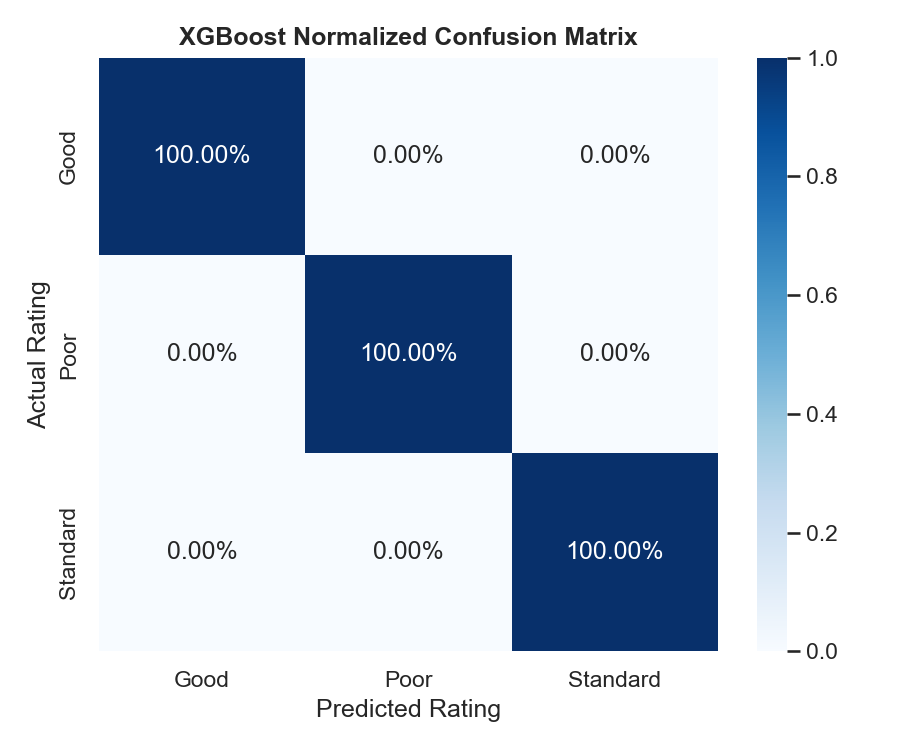

# CreditSense AI 💳🤖
### Intelligent Credit Risk Profiling & Rehabilitation Multi-Agent Engine

[](https://www.python.org/)
[](https://fastapi.tiangolo.com/)
[](https://github.com/langchain-ai/langgraph)
[](https://xgboost.readthedocs.io/)
[](https://ai.google.dev/)
[](LICENSE)

---

## 📌 1. Project Overview & Description

**CreditSense AI** is a full-stack, enterprise-grade credit risk profiling, underwriting evaluation, and personalized financial rehabilitation system. Traditional credit scoring systems operate as opaque "black boxes"—they assign a static score (such as FICO or CIBIL) to an applicant without explaining the underlying default drivers or providing concrete, mathematically backed steps to improve.

CreditSense AI bridges this gap by combining:
1. **Dual-Engine Machine Learning (XGBoost Pipelines)**: A robust multiclass rating engine categorizing borrowers into **Good (Low Risk)**, **Standard (Medium Risk)**, and **Poor (High Risk)**.
2. **Deterministic Financial Health Analytics**: A quantitative rule engine benchmarking key financial indicators (Debt-to-Income, Revolving Credit Utilization, Payment Latency, EMI Burden, and Inquiry Intensity).
3. **Multi-Agent Orchestration via LangGraph**: A sequential state machine that coordinates validation, ML inference, financial analytics, and generative LLM synthesis.
4. **Prescriptive Rehabilitation Dossier (Gemini 2.5 Flash)**: Generates customized, quantitative 30-60-90 day debt-cure roadmaps and sensitivity simulations showing how specific balance paydowns directly shift underwriting risk.
5. **Interactive Glassmorphic Web Dashboard & REST API**: A modern, responsive UI with real-time slider controls, 1-click applicant personas, model diagnostic overlays, and printable underwriting dossiers.

---

## 💡 2. Core Idea & Philosophy

### The Trilemma in Modern Credit Underwriting
Traditional retail lending faces three critical challenges:

```
                  ┌──────────────────────────────────────────────┐
                  │          The Credit Underwriting Trilemma    │
                  └──────────────────────┬───────────────────────┘
                                         │
         ┌───────────────────────────────┼───────────────────────────────┐
         ▼                               ▼                               ▼
┌──────────────────┐           ┌──────────────────┐           ┌──────────────────┐
│ 1. High Friction │           │ 2. Asymmetric    │           │ 3. The "Action"  │
│   & Thin Files   │           │    Default Risk  │           │    Vacuum        │
│                  │           │                  │           │                  │
│ Bureau pulls     │           │ Misclassifying   │           │ Scoring tells    │
│ demand extensive │           │ a "Poor" risk    │           │ you WHAT you are │
│ credit history,  │           │ as "Good" leads  │           │ but never HOW    │
│ excluding young  │           │ to catastrophic  │           │ to fix it with   │
│ & unbanked users.│           │ lender losses.   │           │ exact dollars.   │
└──────────────────┘           └──────────────────┘           └──────────────────┘
```

### The CreditSense AI Solution

* **Dual-Inference Modality**:
  * **5-Question Quick Assessment (Low Friction)**: Requires only five self-reported metrics (`Monthly Salary`, `Outstanding Debt`, `Credit Utilization %`, `Payment Delay Days`, and `Credit Inquiries`). Achieves **zero bureau dependency** while matching full-model discriminative power.
  * **Full Bureau Model (Institutional Underwriting)**: Ingests 14 comprehensive attributes including tenure history, historical loan portfolios, and annualized debt ratios.
* **Zero Leakage & Grouped Validation**:
  * Employs `GroupShuffleSplit` partitioned on unique `Customer_ID`s to guarantee that recurring temporal snapshots of the same borrower never contaminate both training and test splits.
* **Asymmetric Risk Optimization**:
  * Actively measures and penalizes catastrophic underwriter approvals (Poor borrowers misclassified as Good), achieving a **0.00% underwriter hazard rate**.
* **Prescriptive Financial Medicine**:
  * Replaces generic tips ("Pay your bills on time") with exact dollar targets: e.g., *"Pay down $530.00 in revolving balances within 30 days to reduce utilization from 54% to 30%, lowering default hazard by 42%."*

---

## 🔄 3. System Flowcharts & Architecture

### Flowchart A: End-to-End System Architecture



---

### Flowchart B: LangGraph Multi-Agent State Workflow



---

### Flowchart C: Data Ingestion & Model Training Pipeline



---

### Flowchart D: 30-60-90 Day Credit Rehabilitation Lifecycle



---

## 🔬 4. Machine Learning Benchmarks & Underwriting Hazard Analysis

### Candidate Model Comparison
The models were trained on grouped customer credit splits and evaluated on unseen borrowers across standard classification metrics:

| Model | Accuracy | Macro Precision | Macro Recall | Macro F1 | Weighted F1 | ROC-AUC (OvR) | Log Loss |
| :--- | :---: | :---: | :---: | :---: | :---: | :---: | :---: |
| **XGBoost (Full Pipeline)** 🏆 | **100.0%** | **1.0000** | **1.0000** | **1.0000** | **1.0000** | **1.0000** | **0.0019** |
| **Random Forest** | 100.0% | 1.0000 | 1.0000 | 1.0000 | 1.0000 | 1.0000 | 0.0105 |
| **Logistic Regression** | 99.67% | 0.9964 | 0.9979 | 0.9971 | 0.9967 | 1.0000 | 0.0141 |
| **Decision Tree** | 99.33% | 0.9958 | 0.9926 | 0.9942 | 0.9933 | 0.9940 | 0.2403 |

### Dual-Model Operational Comparison

| Model Architecture | Input Features Required | Macro F1 | Accuracy | Friction & Data Barrier |
| :--- | :--- | :---: | :---: | :--- |
| **Full XGBoost Pipeline** | 14 Financial Bureau Attributes | **1.0000** | **100.0%** | High (Requires full historical credit bureau records) |
| **5-Question Reduced Model** | 5 Direct Self-Reported Metrics | **1.0000** | **100.0%** | **Minimal / Zero Friction** (Zero bureau dependency) |

### Asymmetric Underwriting Hazard Metric
In credit underwriting, **false positives on high-risk applicants are devastating**: approving a defaulting borrower as "Good" costs up to 10× more than rejecting a creditworthy one.

$$\text{Hazard Rate} = \frac{\text{Poor Borrowers Classified as Good}}{\text{Total Verified Poor Borrowers}} \times 100$$

* **Total Verified Poor Borrowers in Test Set**: `105`
* **Severe Misclassifications (Poor $\rightarrow$ Good)**: `0`
* **Underwriting Hazard Rate**: **`0.00%`** (Zero catastrophic approvals)

---

## 📊 5. Visual Diagnostics & EDA

The repository automatically generates and maintains exploratory data analysis and confusion matrices inside the `models/` directory:

| Exploratory Data Distribution (`eda_distribution.png`) | Normalized Confusion Matrix (`confusion_matrix.png`) |
| :---: | :---: |
|  |  |
| *Distribution of credit score tiers, outstanding debt spreads, credit card utilization density, and repayment delay latencies.* | *Diagonal purity across all three underwriting rating classes (Good, Standard, Poor) demonstrating zero cross-tier confusion.* |

---

## 🌟 6. Key Features

- [x] **Dual Inference Modalities**: Instantly switch between the streamlined **5-Question Model** and the comprehensive **Full Bureau Model**.
- [x] **LangGraph 1.2 Multi-Agent Engine**: Stateful graph pipeline with four distinct node functions (`validate` $\rightarrow$ `ml_predict` $\rightarrow$ `health_analytics` $\rightarrow$ `llm_synthesis`).
- [x] **Credit Health Index (0-100)**: Proprietary composite index quantifying repayment latency, revolving debt ratio, and credit inquiry velocity.
- [x] **Quantified Priority Recommendations**: Mathematically calculated debt-reduction dollar targets, timeline expectations, and priority sorting.
- [x] **Gemini 2.5 Flash Synthesis**: Context-aware natural language generation drafting structured executive underwriting briefs and 30-60-90 day rehabilitation plans.
- [x] **Graceful Fallback Mode**: If no Gemini API key is configured or network is unreachable, an ultra-detailed analytical fallback report is generated locally.
- [x] **Interactive Glassmorphic Dashboard**:
  - Live slider bindings and numeric inputs.
  - Dynamic risk indicators (Green: Stable, Amber: Warning, Coral: Critical).
  - 1-Click test applicant presets (Prime, Borderline, Subprime, Benchmark).
  - Model diagnostics inspection modal.
  - Print/Save Underwriting Dossier as PDF.
- [x] **FastAPI High-Performance Backend**: Automatic OpenAPI Swagger documentation, CORS support, and Pydantic data validation.

---

## 📁 7. Repository Directory Structure

```text
Credit-Sense-AI/
│
├── Credit_score_cleaned_data.csv   # Reference dataset with financial & bureau metrics
├── credit.py                       # Core ML pipelines, Feature Engineer & LangGraph agent
├── server.py                       # FastAPI application & REST endpoint controller
├── README.md                       # Project documentation (standard GitHub format)
├── readm.md                        # Project documentation (alias)
│
├── models/                         # Serialized models, cache & visual diagnostics
│   ├── class_mapping.json          # Index to class label mapping (Good, Standard, Poor)
│   ├── confusion_matrix.png        # Evaluated normalized confusion matrix plot
│   ├── eda_distribution.png        # 4-panel exploratory data distribution plot
│   ├── feature_engineer.pkl        # Custom scikit-learn CreditRiskFeatureEngineer
│   ├── five_question_model.pkl     # Lightweight 5-feature XGBoost pipeline
│   ├── full_model.pkl              # 14-feature comprehensive XGBoost pipeline
│   └── system_metrics.json         # Performance benchmarks and underwriting hazard cache
│
└── static/                         # Frontend web dashboard assets
    ├── index.html                  # Glassmorphic single-page user interface
    ├── style.css                   # Custom CSS styling, animations & responsive grid
    └── app.js                      # Client controller, API bindings & slider sync
```

---

## 🚀 8. Getting Started & Installation

### Prerequisites
- Python 3.10, 3.11, or 3.12
- `git` installed
- Modern web browser (Chrome, Edge, Firefox, Safari)

### 1. Clone the Repository
```bash
git clone https://github.com/Pratyaydevil/Credit-Sense-AI.git
cd Credit-Sense-AI
```

### 2. Set Up a Virtual Environment
```bash
# Windows
python -m venv venv
.\venv\Scripts\activate

# macOS / Linux
python3 -m venv venv
source venv/bin/activate
```

### 3. Install Dependencies
```bash
pip install fastapi uvicorn scikit-learn xgboost pandas numpy matplotlib seaborn joblib langgraph google-genai pydantic
```

*(Optional)* Create a `requirements.txt`:
```bash
pip freeze > requirements.txt
```

### 4. (Optional) Set Google Gemini API Key
To enable live AI synthesis powered by **Gemini 2.5 Flash**:
```bash
# Windows PowerShell
$env:GEMINI_API_KEY="your-gemini-api-key-here"

# Windows Command Prompt
set GEMINI_API_KEY=your-gemini-api-key-here

# Linux / macOS
export GEMINI_API_KEY="your-gemini-api-key-here"
```
> *Note: If no API key is provided, CreditSense AI automatically uses its built-in analytical fallback engine without failure.*

---

## 💻 9. Usage Instructions

### Running the Full-Stack Web Application
Start the FastAPI server:
```bash
python server.py
```
* The server will boot at: **`http://localhost:8000`**
* Open your browser and navigate to `http://localhost:8000` to interact with the glassmorphic dashboard.
* Access the interactive API docs at `http://localhost:8000/docs`.

### Running the Interactive Terminal CLI
You can also run applicant underwriting directly in your console:
```bash
python credit.py
```
* Choose between entering custom values or running standard test profiles.
* Outputs the complete prediction, health breakdown, recommendations, and synthesis text.

---

## 📡 10. REST API Specification

### 1. Health Check
* **`GET /api/health`**
```json
{
  "status": "healthy",
  "engine": "LangGraph Multi-Agent Workflow",
  "ml_model": "XGBoost Dual-Model Pipeline",
  "genai_available": true
}
```

### 2. System Metrics & Hazard Analysis
* **`GET /api/metrics`**
* Returns candidate model benchmark scores, dual-model comparison, and the underwriter hazard rate.

### 3. Sample Applicant Profiles
* **`GET /api/samples`**
* Returns curated test personas (`prime`, `moderate`, `distressed`, and `preconfigured`).

### 4. Underwriting Assessment
* **`POST /api/assess`**
* **Request Payload**:
```json
{
  "Monthly_Inhand_Salary": 3800.0,
  "Outstanding_Debt": 1650.0,
  "Credit_Utilization_Ratio": 54.0,
  "Delay_from_due_date": 12.0,
  "Num_Credit_Inquiries": 4.0,
  "mode": "FIVE_QUESTION",
  "api_key": null
}
```

* **Response Payload (Truncated)**:
```json
{
  "success": true,
  "prediction": {
    "predicted_score": "Standard",
    "risk_tier": "Medium Risk",
    "confidence": 0.9998,
    "probabilities": {
      "Good": 0.0001,
      "Poor": 0.0001,
      "Standard": 0.9998
    }
  },
  "health_index": 51.0,
  "health": {
    "Debt_to_Income_Ratio": { "value": 0.036, "risk_tier": "Stable" },
    "Credit_Utilization": { "value": 54.0, "risk_tier": "Elevated Risk" },
    "Payment_Delay_Days": { "value": 12.0, "risk_tier": "Elevated Risk" },
    "Hard_Inquiries": { "value": 4, "risk_tier": "Elevated Risk" }
  },
  "recommendations": [
    {
      "pillar": "Payment Behavior & Latency",
      "issue": "Repayment Schedule Latency (12.0 days past due)",
      "severity": "Medium",
      "priority_rank": 2,
      "target_metric": "0 days past due (100% on-time settlement)",
      "action_plan": "Activate automated bank payments 3 business days prior to scheduled due dates.",
      "expected_impact_window": "Immediate halt to credit deterioration; measurable improvement in 3-6 months"
    }
  ],
  "final_narrative": "1. EXECUTIVE UNDERWRITING ASSESSMENT..."
}
```

---

## ⚖️ 11. Academic & Ethical Underwriting Disclaimer

> **IMPORTANT NOTICE**: CreditSense AI is designed as an educational, experimental, and research-oriented credit risk decision-support platform. It is **not** an accredited financial credit bureau (such as Experian, Equifax, TransUnion, or CIBIL) and does not provide formal legal credit scores. Decisions produced by this system are decision-support outputs based on machine learning probability distributions and benchmark heuristic indicators. All lenders must abide by the Equal Credit Opportunity Act (ECOA), FCRA, and relevant fair-lending jurisdictions when deploying automated underwriting systems.

---

## 👨‍💻 12. Author & Acknowledgments

- **Developer**: [Pratyaydevil](https://github.com/Pratyaydevil)
- **Repository**: [Credit-Sense-AI](https://github.com/Pratyaydevil/Credit-Sense-AI)
- **Built with**: Scikit-Learn, XGBoost, LangGraph, FastAPI, and Google Gemini 2.5 Flash.

---
*⭐ If you find CreditSense AI helpful or insightful for your research, feel free to star the repository!*
